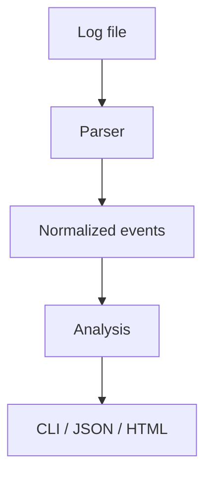

# developer-log-analyzer

A local CLI and Python library for Common/Combined access logs and JSON application logs. It streams input, normalizes records, and calculates traffic, status, error, performance, and IP aggregates.

```sh
pip install -e .
log-analyzer analyze-file app.log --json
log-analyzer report app.log report.html
```

Malformed lines are counted and skipped. IP figures are aggregation only, not identity attribution. Logs and generated reports can contain sensitive data, so review them before sharing.


